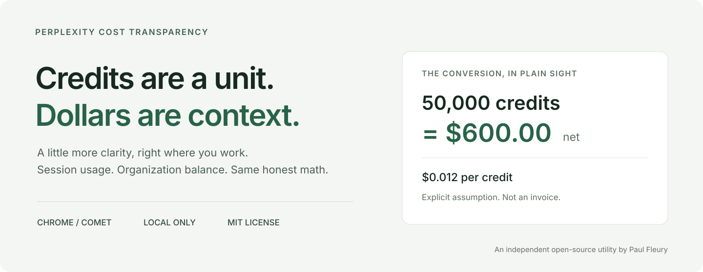
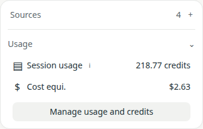
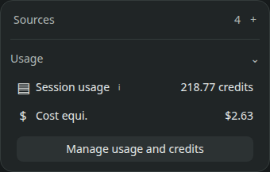
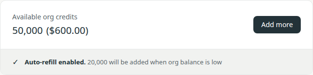

# Perplexity Cost Transparency

<div align="center">




<p>A simple Chromium extension to add more clarity to usage pricing, with conditional Comet compatibility.</p>
<p><a href="#install-in-chrome-or-chromium">Install</a> · <a href="#comet-compatibility">Comet compatibility</a> · <a href="#the-math-no-mystery">The math</a> · <a href="PRIVACY.md">Privacy</a> · <a href="CHANGELOG.md">Changelog</a> · <a href="https://github.com/paulfxyz/ai-credit-checker">AI Credit Checker</a></p>

</div>

> [!WARNING]
> **Comet: loading the extension alone is not enough in the tested macOS setup.** Comet prevented it from running on Perplexity pages until a local administrator approved a policy exception for this extension's exact ID and the browser was fully restarted. The required setup is explained in [Comet compatibility](#comet-compatibility) and the [scoped macOS setup guide](docs/COMET.md); no global extension unblock is needed.
>
> **Moving or reinstalling needs a fresh ID check.** An unpacked extension's ID can change with its directory, so an exception for the old ID will not authorize the new copy ([Chrome's ID notes](https://developer.chrome.com/docs/extensions/mv2/architecture-overview)). Keep the active folder in a permanent location and follow the [relocation or fresh-install instructions](docs/COMET.md#moving-an-unpacked-extension) instead of reusing an old ID blindly.

## One small extension, two useful numbers

Computer shows credits. This extension adds their estimated USD equivalent in the same interface, without replacing the original number.

- **Session usage:** A dollar icon, `Cost equi.` and a right-aligned USD amount, directly below the native Session usage row.
- **Organization balance:** A parenthesized equivalent beside Available org credits on the organization Usage page, such as `50,000 ($600.00)`.
- **Live updates:** Both follow changes to the displayed credits, including text updates, panel rerenders and navigation within the site.
- **Nothing extra:** No popup, dashboard, login, API key, background service, telemetry or runtime dependencies.

<table>
  <tr>
    <th align="left">Session usage · Light</th>
    <th align="left">Session usage · Dark</th>
  </tr>
  <tr>
    <td></td>
    <td></td>
  </tr>
</table>

<picture>
  <source media="(prefers-color-scheme: dark)" srcset="docs/organization-dark.png">
  
</picture>

Screenshots show the actual extension running in Chromium against a small, native-structure test fixture. All balances are sample data; these are not captures of a private account or proof of installation in Comet.

## Install in Chrome or Chromium

No build step is required to use the extension. Download the ZIP from [Releases](https://github.com/paulfxyz/pplx-cost-transparency/releases), extract it, and keep the extracted folder somewhere permanent.

1. Open `chrome://extensions` in the browser where you use Perplexity.
2. Enable **Developer mode**.
3. Click **Load unpacked** and select the extracted folder containing `manifest.json`.
4. Reload any already-open Perplexity tabs.
5. Open a Computer session and expand **Usage**, or visit [organization Usage](https://www.perplexity.ai/account/org/credits-usage).

These are Chrome's standard [unpacked-extension installation steps](https://developer.chrome.com/docs/extensions/get-started/tutorial/hello-world). You can also clone the repository and select its root folder instead:

```sh
git clone https://github.com/paulfxyz/pplx-cost-transparency.git
```

There is no Chrome Web Store submission or automatic updater. To update, replace the files with a newer release, click the extension's reload control, then reload your Perplexity tabs; to remove it, use **Remove** on the Extensions page and reload the tabs.

### Can I delete the download or move the folder?

You can delete the downloaded ZIP after extracting it. An unpacked extension runs from its directory, so the active files must remain available somewhere; they do not have to stay in Downloads ([Chrome extension formats](https://developer.chrome.com/docs/chromedriver/extensions)).

Choose a permanent folder before loading it where possible. If you move an already-loaded extension, load it from the new location and check its new ID; an unpacked extension's ID can change with its directory, so an ID-specific Comet exception may need to move with it ([Chrome's ID notes](https://developer.chrome.com/docs/extensions/mv2/architecture-overview)).

Version 1.1.0 includes an optional `migrate OLD_ID NEW_ID` helper command for that policy change. It does not move files or re-register the extension for you; see the [relocation checklist](docs/COMET.md#moving-an-unpacked-extension).

If you deleted the previous setup and its policy, use `preview` and `apply` for the newly verified ID rather than `migrate`. If the old scoped exception still exists, use `migrate` to replace it; the helper deliberately stops when its assumptions do not match the actual policy.

## Comet compatibility

**Enabling the extension in Comet is not sufficient in the default configuration.** The Complexity and Quorum maintainers document that Comet blocks third-party extensions from operating on `perplexity.ai`, even when the extension itself is installed and enabled ([Complexity's report](https://github.com/pnd280/complexity/blob/nxt/perplexity/extension/docs/articles/comet-enable-extensions-article.md), [Quorum's macOS notes](https://github.com/JacobStephens2/quorum-perplexity-council-tracker/blob/main/docs/comet-setup.md)).

### Why nothing appeared

This extension relies on a content script to read the visible credit count and add the USD equivalent inside the page. If Comet prevents that script and its stylesheet from loading, the extension can be switched on and correctly installed yet display nothing; ordinary site-access grants do not remove that separate restriction ([Quorum's macOS notes](https://github.com/JacobStephens2/quorum-perplexity-council-tracker/blob/main/docs/comet-setup.md)).

That is what happened in our initial installed Comet/macOS check: version 1.0.0 was enabled, its files matched the release and both Perplexity origins were granted, but neither the cost UI nor the stylesheet was injected. The converter was not failing to calculate dollars; the browser was not allowing the page integration to run.

### What was required to make it work

After separate approval and local administrator authorization, we created a narrowly scoped managed policy at `/Library/Managed Preferences/ai.perplexity.comet.plist`. Its `ExtensionSettings` entry applied only to the installed extension ID, with `runtime_allowed_hosts` limited to `https://perplexity.ai` and `https://www.perplexity.ai`, plus an empty `runtime_blocked_hosts` list for that same extension.

A full Comet restart was necessary in this test; reloading the policy page alone had not picked up the new file. After restart, Comet reported the scoped `ExtensionSettings` policy as `OK`, both USD displays appeared from the installed extension, the session amount followed a real credit-count change, and collapsing/reopening Usage produced no duplicate row.

**I personally confirmed that both dollar amounts were visible in my Comet browser on October 18, 2026.** No new extension build was needed: the successful fix was the approved browser-policy exception and restart, not a change to the conversion code.

We did not unblock every extension, change a global scripting flag or restart a preference daemon. The setup recorded the original policy state and a file hash for guarded rollback; the [setup and undo guide](docs/COMET.md) explains the boundaries and how to preserve existing policies.

### Why setup was needed again after reinstalling

Later the same day, I removed the earlier copy and policy, extracted version 1.1.0 into a permanent folder, and loaded it again. The new directory produced a different extension ID, and there was no remaining policy entry to authorize that ID.

We verified the actual loaded path and ID, checked the release files, ran the helper's read-only preview, then applied a fresh exception after local administrator approval and a typed `APPLY` confirmation. After a full Comet restart, both dollar displays passed the live checks, the session row survived collapse/reopen without duplication, and I confirmed they were visible.

This was not a changed exchange rate or a broken USD calculation. The earlier issue was Comet's page-access restriction; the reinstall additionally required the exception to match the new installation identity, as described in [Chrome's ID notes](https://developer.chrome.com/docs/extensions/mv2/architecture-overview).

The exact local folder and installed IDs are intentionally omitted here. Use your own current ID from `chrome://extensions`, retain the active folder, and never broaden the exception to every extension just to avoid repeating setup.

### Optional setup, migration and undo helper

Version 1.1.0 adds [`comet/setup.sh`](comet/setup.sh) and its policy planner. Nothing runs automatically: the helper requires macOS and Node.js 20+, while the extension itself remains plain JavaScript/CSS with no runtime dependencies.

From the extracted extension folder or repository root:

```sh
# Read-only inspection and preview
/bin/bash comet/setup.sh status YOUR_EXTENSION_ID
/bin/bash comet/setup.sh preview YOUR_EXTENSION_ID

# Administrator approval plus an explicit APPLY confirmation
/bin/bash comet/setup.sh apply YOUR_EXTENSION_ID

# Move only the scoped exception after re-registering from another folder
/bin/bash comet/setup.sh migrate OLD_EXTENSION_ID NEW_EXTENSION_ID

# Undo the helper's change, preserving unrelated current policies
/bin/bash comet/setup.sh undo YOUR_EXTENSION_ID
```

Use actual IDs from `chrome://extensions`, not the placeholder text. The helper validates IDs, refuses wildcard IDs and unexpected existing entries, makes local recovery records, detects changes during review, and asks for `APPLY`, `MIGRATE` or `UNDO` before writing.

It does not download software, restart Comet, kill preference daemons or enable every extension. Read the [helper safety and recovery notes](docs/COMET.md#using-the-optional-helper) before running it; an existing matching rule is not silently adopted for undo.

### Installation choices and limits

- **Standard-browser route:** Use the normal unpacked installation in a Chrome/Chromium profile that permits the extension. The automated installation tests use Chromium.
- **Verified scoped Comet route:** The per-extension `ExtensionSettings` / `runtime_allowed_hosts` approach worked in the tested macOS installation. See the [setup and undo guide](docs/COMET.md); this is not a guarantee for every Comet version or managed environment, and the general approach is also documented by another extension maintainer ([Quorum's macOS notes](https://github.com/JacobStephens2/quorum-perplexity-council-tracker/blob/main/docs/comet-setup.md)).
- **Security boundary:** Such an exception changes browser security configuration and can require administrator approval and a full restart. It is not a JavaScript fix, and this extension does not apply one automatically ([Quorum's macOS notes](https://github.com/JacobStephens2/quorum-perplexity-council-tracker/blob/main/docs/comet-setup.md)).
- **Keep the scope narrow:** Do not assume a global “enable all extensions on Perplexity” patch is equivalent to allowing this one small utility. Perplexity documents support for managed extension policies, but those policies need deliberate administrative review ([Comet policies and controls](https://www.perplexity.ai/help-center/en/articles/13529668-comet-policies-and-controls)).

The restriction is documented for other extensions too; this project has no evidence that it specifically targets cost-transparency tools. An absent row is therefore not, by itself, proof of a broken converter or of pricing-specific interference.

## The math, no mystery

The project uses one explicit assumption supplied by its author: **50,000 credits cost $600 brut**. It is a fixed conversion assumption, not a claim about every Perplexity plan or an official pricing feed.

```text
USD per credit = 600 / 50,000 = 0.012
USD equivalent = displayed credits × 0.012
```

| Displayed credits | USD equivalent |
| ---: | ---: |
| 1 | $0.01 |
| 100 | $1.20 |
| 218.77 | $2.63 |
| 1,000 | $12.00 |
| 50,000 | $600.00 |

Amounts are formatted in USD to two decimal places. A positive equivalent below one cent shows `<$0.01` rather than implying it is free.

Hover over either addition to see the rate and qualification. The constants are intentionally easy to audit or change in [`src/cost.js`](src/cost.js); reload the extension and page after a change.

- **Equivalent, not invoice:** Taxes, discounts, included credits, promotions, different purchase rates and provider billing adjustments are not modeled.
- **Usage versus balance:** The session row estimates the equivalent of credits used. The organization suffix estimates the equivalent of the available shared pool, not money spent, an individual allowance or a cash-redeemable balance.
- **As fresh as the source:** The extension follows the visible number. It cannot make delayed or rounded provider reporting more precise, refresh an account independently, or reveal unreported charges.
- **Visibility, not enforcement:** It does not predict task costs, impose a spending cap, pause work or change billing settings.

## Why this exists

Credit-based interfaces add a layer of mental arithmetic between an action and its economic cost. We should not have to keep a calculator open to understand what a session represents in dollars.

### The irony, and the red flag

Yes, this open-source code was, ironically, designed with **Perplexity Computer**. I am using the product to fix a cost-transparency problem in the product.

I am an **Enterprise Max customer spending thousands per month**. This criticism comes from sustained, paid use, not a passing impression from someone who has never used the service.

I find Perplexity's pricing strategy dubious. The way costs are labeled, surfaced, or sometimes not made available is, in my view, not transparent enough to give customers real control.

Perplexity also declined my request for support for my open-source work, including a modest grant of credits. Combined with the opacity I experience around costs, that is a **RED FLAG** for me.

I am not going to rank competing vendors here. In my opinion, there are already better alternatives for builders and, especially, large companies that take cost control seriously, including sovereign and self-hosted solutions.

This is my experience and assessment as the project's author. The extension is a quick, open-source UI fix that puts the conversion in plain sight, not an endorsement of the pricing model or a claim to audit the underlying billing.

### Two complementary cost-control tools

For me, **Perplexity Cost Transparency and AI Credit Checker are critical parts of keeping AI costs under control**. They address two different questions:

- **Perplexity Cost Transparency:** “What does this session's credit usage represent in USD, and what is the equivalent of the available organization pool?”
- **[AI Credit Checker](https://github.com/paulfxyz/ai-credit-checker):** “What balances are available across my tools?” The companion macOS app monitors Perplexity, OpenRouter, Fly.io and Runware from the menu bar.

Together, they make cost information easier to see and compare. The goal is to avoid being left in the dark by non-transparent pricing policies or credit abstractions, not to suggest that a local conversion can audit a provider's billing.

Transparent assumptions matter as much as visible numbers. The rate, source code and limitations are all public, so the tool can be inspected rather than simply trusted.

### An open invitation to the Perplexity team

If the Perplexity team is reading this, please feel free to [contact me through this repository]([https://github.com/paulfxyz/pplx-cost-transparency/issues](https://github.com/paulfxyz/mediakit/)). I would be open to becoming a product evangelist if you address these issues, make costs genuinely transparent, and back open-source initiatives with practical support, including a modest credit grant for this work.

I would much rather help improve a product I can confidently recommend than keep building workarounds for it. This is an invitation to a constructive conversation, not just a complaint.

## Small by design

```text
Displayed session credits ──→ Cost equi.     $2.63
                             shared rate: $0.012 / credit
Available org credits ──────→ 50,000 ($600.00)

DOM change → local conversion → updated text
```

The extension uses a `MutationObserver`, not periodic network polling. It preserves the native values, reuses the site's row styles, batches updates and avoids unnecessary writes.

Only the English Session usage information button and the exact Available org credits / organization credits / organisation credits labels are supported. It deliberately avoids reading refill amounts, grant history or member-usage totals as the available pool.

For single-page navigation, the manifest permits content scripts on `https://www.perplexity.ai/*` and `https://perplexity.ai/*`. UI changes are restricted in code to `/computer/tasks/<session>` and `/account/org/credits-usage`; there are no privileged API permissions and no access to unrelated sites.

## Privacy and limitations

All conversion happens inside the browser. The extension does not send network requests, store balances, read cookies, intercept APIs or collect account/session history; see [Privacy](PRIVACY.md).

- **DOM changes can break detection:** The host website controls its markup. If a label or layout is no longer recognized, the extension may show no addition rather than guess.
- **Unreadable is not zero:** Recognized loading states show `Unavailable`. Unsupported organization count formats hide the suffix until a readable balance returns.
- **Compact values are not invented:** Counts such as `50k` are not expanded into a falsely precise balance.
- **Browser policy takes precedence:** Passing Chromium tests does not establish that a managed Chrome profile or Comet allows the extension on Perplexity pages.

The current validation approach and manual acceptance boundary are documented in [Validation](docs/VALIDATION.md). Please report a changed layout with a redacted screenshot rather than sharing account data.

## Develop and test

Node.js 20 or later is needed only for development. The installed extension itself is plain JavaScript and CSS.

```sh
npm ci
npm test
npx playwright install chromium
npm run test:browser
npm run test:comet  # macOS-only, temporary fixtures; no real policy changes
npm run screenshots
npm run package
```

The browser suite loads the real unpacked extension in isolated Chromium and intercepts navigation with synthetic fixtures. It exercises both displays, updates, rerenders, navigation, error recovery, light/dark inheritance and narrow layouts without signing in.

The packaging script writes a versioned install ZIP and `SHA256SUMS.txt` to `dist/`, including the optional `comet/` helper files. It uses an explicit file allowlist and requires the standard `zip` command, available on macOS/Linux or through WSL.

## Open source, honestly

Designed and built by Paul Fleury with Perplexity Computer, as a small practical tool rather than an authoritative billing system. The code is intentionally readable, with tests and limitations published alongside it.

This is an independent community project, not affiliated with or endorsed by Perplexity or Google. The source code and original documentation graphics are available under the [MIT License](LICENSE).
